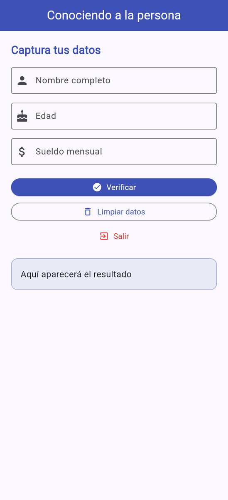
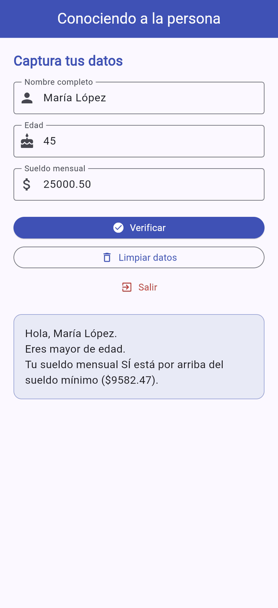
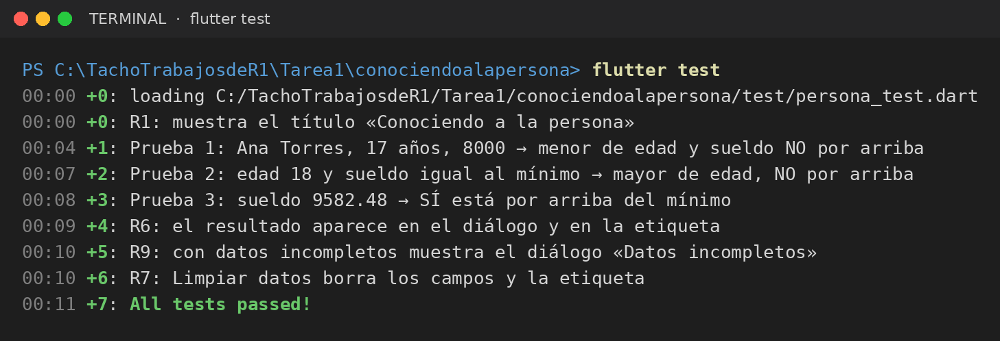
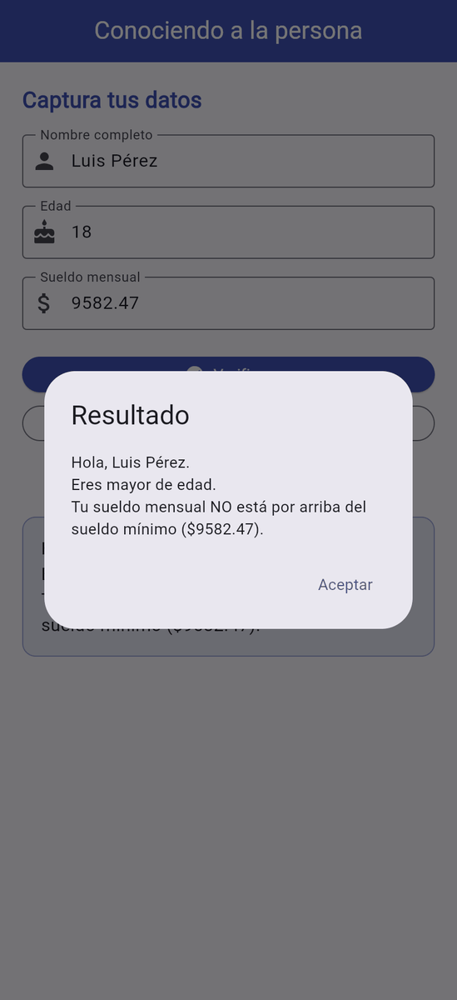
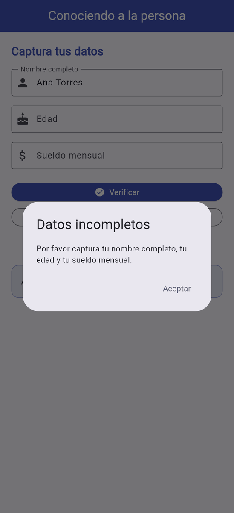

# Conociendo a la persona

Aplicación móvil en **Flutter / Dart** que captura el nombre, la edad y el sueldo mensual de una persona, valida los datos y muestra si es mayor de edad y si su sueldo está por arriba del sueldo mínimo.

| | |
|---|---|
| **Alumno** | Cristopher Gerardo Villanueva Ramirez |
| **Grupo** | GTID244 |
| **Materia** | Desarrollo de Aplicaciones Móviles |
| **Archivo principal** | [`lib/main.dart`](lib/main.dart) |

---

## Requisitos de la práctica

| N.º | Requisito |
|---|---|
| R1 | La pantalla muestra el título **«Conociendo a la persona»**. |
| R2 | El usuario puede capturar **nombre completo**, **edad** y **sueldo mensual**. |
| R3 | Al presionar **Verificar**, la app saluda a la persona por su nombre. |
| R4 | Indica si la persona es **mayor de edad** (18 años o más) o menor de edad. |
| R5 | Indica si el sueldo está **por arriba del sueldo mínimo** ($9,582.47). |
| R6 | El resultado se muestra **en un diálogo** y **en una etiqueta** en pantalla. |
| R7 | **Limpiar datos** borra los campos y la etiqueta. |
| R8 | **Salir** cierra la aplicación. |
| R9 | Si falta algún dato, la app avisa con un diálogo en lugar de fallar. |

**Reglas de negocio**

- Mayor de edad si `edad >= 18`.
- Sueldo «por arriba» solo si `sueldo > 9582.47`. Si es igual al mínimo, **no** cuenta como «por arriba».

---

## La app funcionando

<table>
  <tr><td align="center"><br><sub>Pantalla inicial</sub></td><td align="center"><br><sub>Resultado en diálogo</sub></td><td align="center"><br><sub>Resultado en la etiqueta</sub></td></tr>
</table>

---

## Tecnologías y conceptos usados

- `StatelessWidget` (`MyApp`) y `StatefulWidget` (`PantallaPrincipal`)
- `Scaffold`, `AppBar`, `TextField`, `ElevatedButton`, `OutlinedButton`, `TextButton`, `Container`
- `TextEditingController` y `dispose()`
- Tipos `String`, `int`, `double`, `bool`; constantes `static const`
- `int.tryParse` / `double.tryParse` y tipos nulos (`int?`, `double?`)
- `if / else`, operadores `>=`, `>` y `||`
- `setState()` para redibujar la pantalla
- `showDialog` + `AlertDialog`
- `FilteringTextInputFormatter` para limitar la entrada
- `SystemNavigator.pop()` para cerrar la app

---

## Cómo ejecutar el proyecto

```bash
flutter create conociendo_persona
cd conociendo_persona
# Reemplaza lib/main.dart por el de este repositorio
flutter pub get
flutter run
```

> Se recomienda un emulador o dispositivo **Android**. El botón **Salir** no tiene efecto en iOS ni en la web.

---

## Pruebas (Paso 11)

| # | Datos de entrada | Resultado esperado | Resultado obtenido |
|---|---|---|---|
| 1 | Ana Torres · 17 · 8000 | Menor de edad; sueldo NO por arriba | ✅ Correcto |
| 2 | Luis Pérez · 18 · 9582.47 | Mayor de edad; sueldo NO por arriba (es igual) | ✅ Correcto |
| 3 | Carla Ruiz · 30 · 9582.48 | Mayor de edad; sueldo SÍ por arriba | ✅ Correcto |
| 4 | María López · 45 · 25000.50 | Mayor de edad; sueldo SÍ por arriba | ✅ Correcto |
| 5 | Campos vacíos o solo el nombre | Diálogo «Datos incompletos» | ✅ Correcto |
| 6 | Presionar Limpiar datos | Campos y etiqueta quedan vacíos | ✅ Correcto |
| 7 | Presionar Salir | La app se cierra (en Android) | ✅ Correcto |

### Pruebas automatizadas (`flutter test`)

Resultado de correr `flutter test`: **7 pruebas pasan** (*All tests passed!*). Las pruebas están en [`test/persona_test.dart`](test/persona_test.dart).



### Capturas de pantalla

**Prueba 1: Ana Torres · 17 · 8000**


**Prueba 2: Luis Pérez · 18 · 9582.47**



**Prueba 3: Carla Ruiz · 30 · 9582.48**


**Prueba 4: María López · 45 · 25000.50**


**Prueba 5: Datos incompletos**



**Prueba 6: Limpiar datos**


**Prueba 7: Salir**

El botón **Salir** cierra la app en Android con `SystemNavigator.pop()`. En la versión web, que se usó para tomar estas capturas, el botón no tiene efecto.

---

## Preguntas de comprobación

**1. ¿Cuál es la diferencia entre un StatelessWidget y un StatefulWidget? ¿Por qué PantallaPrincipal tuvo que ser StatefulWidget?**

Un `StatelessWidget` se dibuja una vez y no cambia, porque no guarda datos que varíen. Un `StatefulWidget` conserva un estado y puede redibujarse cuando ese estado cambia. `PantallaPrincipal` tuvo que ser Stateful porque el texto de la etiqueta de resultado cambia al presionar **Verificar** o **Limpiar datos**.

**2. ¿Para qué sirve un TextEditingController y por qué se libera con dispose() al cerrar la pantalla?**

Un `TextEditingController` permite leer lo que el usuario escribió en un `TextField` y también modificarlo o borrarlo (`clear()`). Se libera con `dispose()` porque ocupa memoria y recursos; si no se liberara al cerrar la pantalla, quedaría ocupando memoria sin necesidad (fuga de memoria).

**3. Si en `_verificar()` quitas el `setState(() { ... })` y dejas solo `_resultado = mensaje;`, ¿qué dejaría de funcionar: el diálogo o la etiqueta?**

Dejaría de funcionar la etiqueta. Sin `setState`, la variable `_resultado` sí cambia en memoria, pero Flutter no se entera y no vuelve a ejecutar `build()`, así que la pantalla sigue mostrando el texto anterior. El diálogo seguiría funcionando porque recibe el mensaje directamente en `_mostrarDialogo(...)` y no depende de redibujar la pantalla.

**4. ¿Qué valor devuelve `int.tryParse('abc')` y qué ventaja tiene usarlo en lugar de `int.parse('abc')`?**

`int.tryParse('abc')` devuelve `null`. La ventaja sobre `int.parse('abc')` es que este último lanza una excepción (`FormatException`) que detiene la app si no se controla. `tryParse` no falla, y con `if (edad == null)` se puede mostrar un diálogo de «Datos incompletos» en lugar de que la app se rompa.

**5. Un usuario captura edad = 18 y sueldo = 9582.47. ¿Qué mensajes mostrará la app?**

- «Eres mayor de edad.», porque `edad >= edadMayoria` es `18 >= 18`, que es verdadero. El operador `>=` incluye el 18.
- «Tu sueldo mensual NO está por arriba del sueldo mínimo ($9582.47).», porque `sueldo > sueldoMinimo` es `9582.47 > 9582.47`, que es falso. El operador `>` es estricto, así que un sueldo igual al mínimo no cuenta como «por arriba».
